# parsnip-node

A rugged, self-contained Meshtastic/MeshCore LoRa node for outdoor use. It combines an
ESP32-S3 host, an Ebyte E22P-915M30S LoRa module (SX1262 + PA, up to 30 dBm / 1 W), and a
u-blox NEO-F10N dual-band (L1 + L5) GNSS receiver, and runs off two 21700 Li-ion cells
in series that charge over USB-C PD or solar. Designed in KiCad for 915 MHz operation in
Canada under ISED RSS-247.

The aim is a node that non-technical people can use without a phone: one of the
longest-range, best-value LoRa front ends, accurate GNSS, days of runtime, and protection
on every external port.

<p align="center">
  <picture>
    <source srcset="lib/img/render-spin.avif" type="image/avif">
    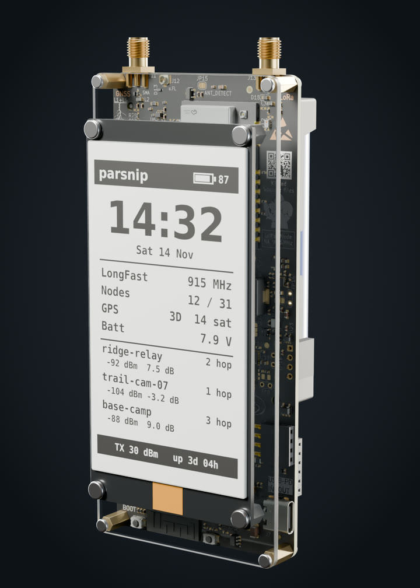
  </picture>
  <br><sub>Render, see (<a href="code/render/render.sh">code/render</a>), with two 21700 cells and the optional WeAct 3.7" E-Ink module on M2 standoffs and a clear top plate. The display mount is a mock-up, not part of the board yet.</sub>
</p>

## Status

**v2 (this design):** schematic complete, PCB placed and fully routed (478 footprints, every
net one piece of copper). Prototype fab and assembly are being arranged with PCBWay.
Firmware bring-up starts once boards arrive.

**v1** (single 18650, XIAO ESP32-C6, 55 x 100 mm) was built and field-tested; photos are
at the [bottom](#v1-in-the-field). The design log is in [JOURNAL.md](JOURNAL.md).

## Features

| Block | Implementation |
| --- | --- |
| Host | ESP32-S3-WROOM-1U-N16R8 (16 MB flash, 8 MB octal PSRAM), U.FL 2.4 GHz antenna. The footprint is the WROOM-1 land pattern, so the PCB-antenna module also fits. |
| LoRa | E22P-915M30S, 915 MHz, up to 30 dBm, SMA. An antenna-detect FET inhibits TX when no antenna is attached. |
| GNSS | NEO-F10N, L1 + L5 (NEO-M9N footprint-compatible fallback). Active antenna on SMA or U.FL, switched bias-tee, dual-band SAW, 6 dB pi pad. Coin-cell backup for hot starts. |
| Battery | 2S 21700 Li-ion in SMD holders on the back. MAX17320 fuel gauge, protection and cell balancing. |
| Charger | BQ25798 buck-boost NVDC charger with dual-input power mux (USB-C or solar). Regulated ~7-8.4 V system rail. |
| USB-C | TPS25751 PD controller: sink, and source (OTG) up to 20 V @ 3 A. TPD8S300 OVP/ESD on CC/SBU, liquid detection. USB 2.0 full speed to the ESP32-S3. |
| Rails | Two LM61460 low-EMI bucks (5 V, 3.3 V), synchronised 180 deg out of phase at 2 MHz. TPS25947-family eFuses on the 5 V and GNSS rails. |
| Sensors | LSM6DSV16X 6-axis IMU, QMC6309 magnetometer. |
| I/O | 16-pin GPIO expander header (TCAL9539), Qwiic and 2.54 mm I2C ports, SPI expansion, E-Ink header, 2 x WS2816B RGB LEDs plus an external LED port, debug UART. |
| Board | 60 x 130 mm, 4 layers, 1.6 mm, ENIG, black mask. |

All charger and battery-path parts are rated for 4S (caps 25 V minimum, mostly 50 V) even
though the pack is 2S.

## Architecture

<table>
  <tr>
    <td align="center" width="50%">
      <a href="lib/img/schematic-block-diagram.png">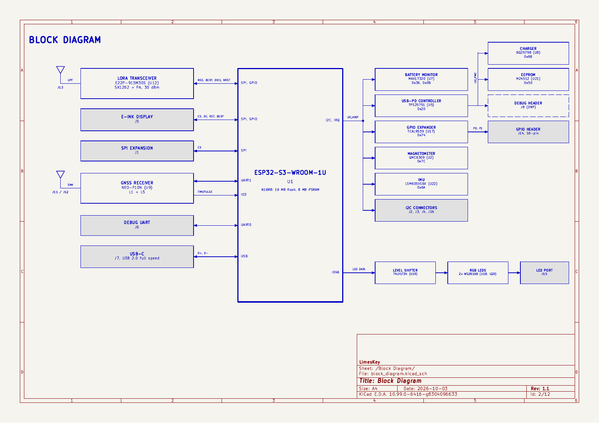</a>
      <br><sub><b>Block diagram</b></sub>
    </td>
    <td align="center" width="50%">
      <a href="lib/img/schematic-power-tree.png">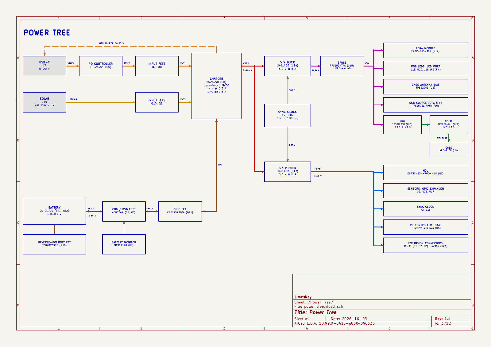</a>
      <br><sub><b>Power tree</b></sub>
    </td>
  </tr>
</table>

Power flows cells -> fuse -> MAX17320 protection FETs -> BQ25798 -> **VSYS** (regulated,
not raw battery) -> the 3.3 V and 5 V bucks. The 5 V rail feeds the E22P, the LED port and
the GNSS antenna bias. The GNSS module gets its own LDO and eFuse off 5 V. USB-C (through
the PD controller) and solar each have their own FET path into the charger, and the
first valid input wins.

## Schematic

The full schematic is [parsnip-schematic.pdf](parsnip-schematic.pdf) (12 pages: cover,
block diagram, power tree, then the circuit sheets). Click a page for full size.

<table>
  <tr>
    <td align="center" width="33%">
      <a href="lib/img/schematic-mcu.png">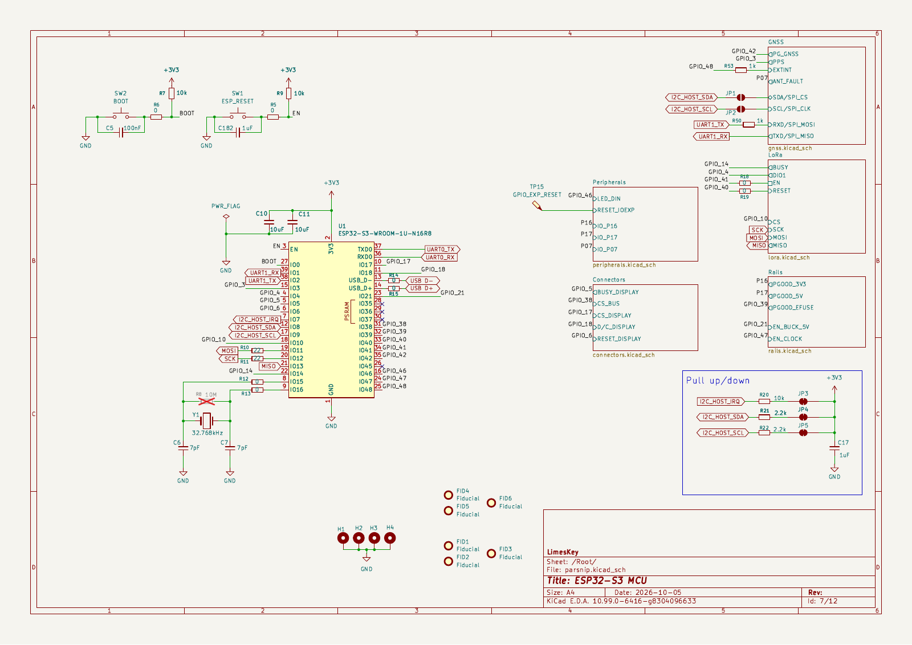</a>
      <br><sub><b>ESP32-S3 MCU</b></sub>
    </td>
    <td align="center" width="33%">
      <a href="lib/img/schematic-lora.png">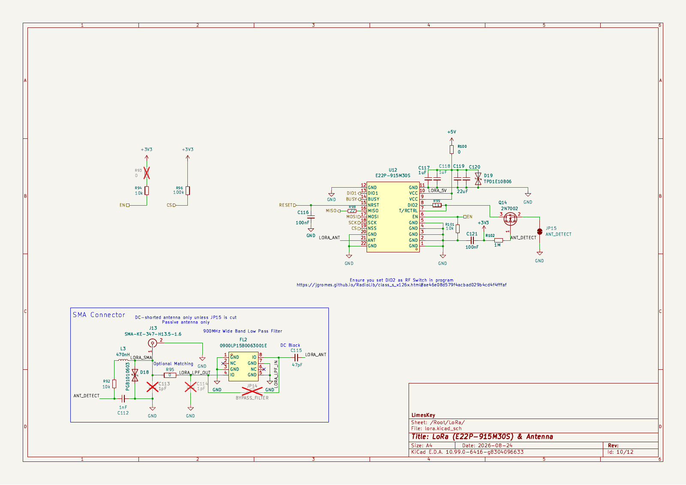</a>
      <br><sub><b>LoRa (E22P-915M30S)</b></sub>
    </td>
    <td align="center" width="33%">
      <a href="lib/img/schematic-gnss.png">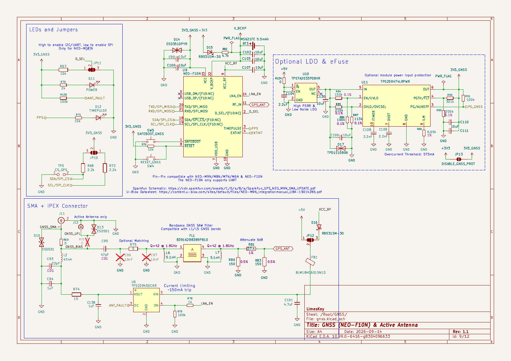</a>
      <br><sub><b>GNSS (NEO-F10N)</b></sub>
    </td>
  </tr>
  <tr>
    <td align="center" width="33%">
      <a href="lib/img/schematic-rails.png">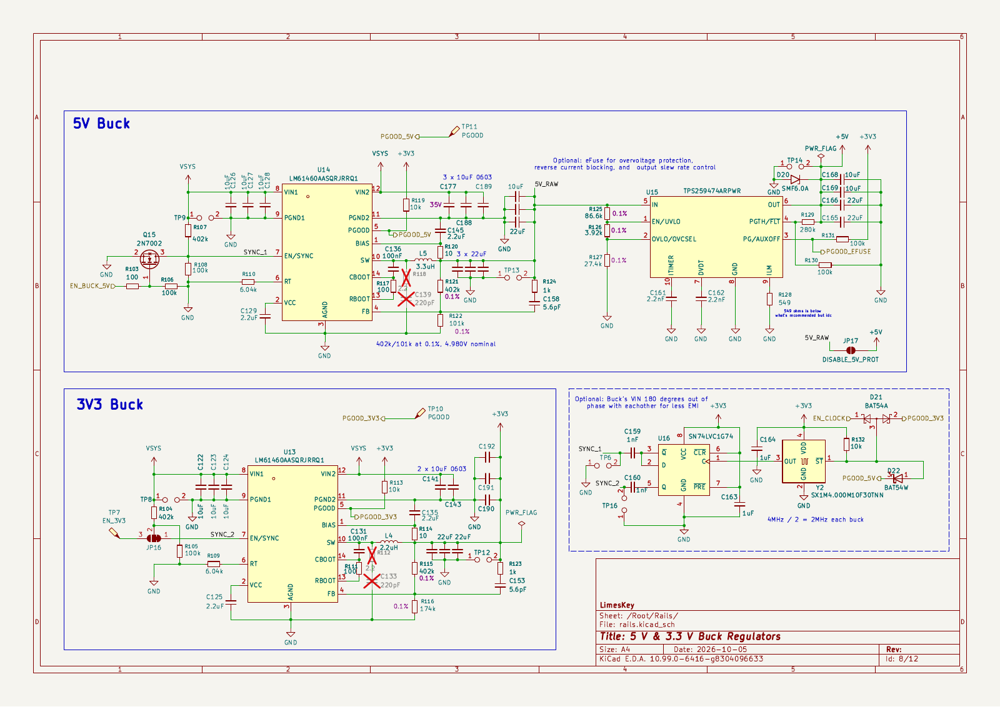</a>
      <br><sub><b>5 V / 3.3 V bucks</b></sub>
    </td>
    <td align="center" width="33%">
      <a href="lib/img/schematic-charger.png">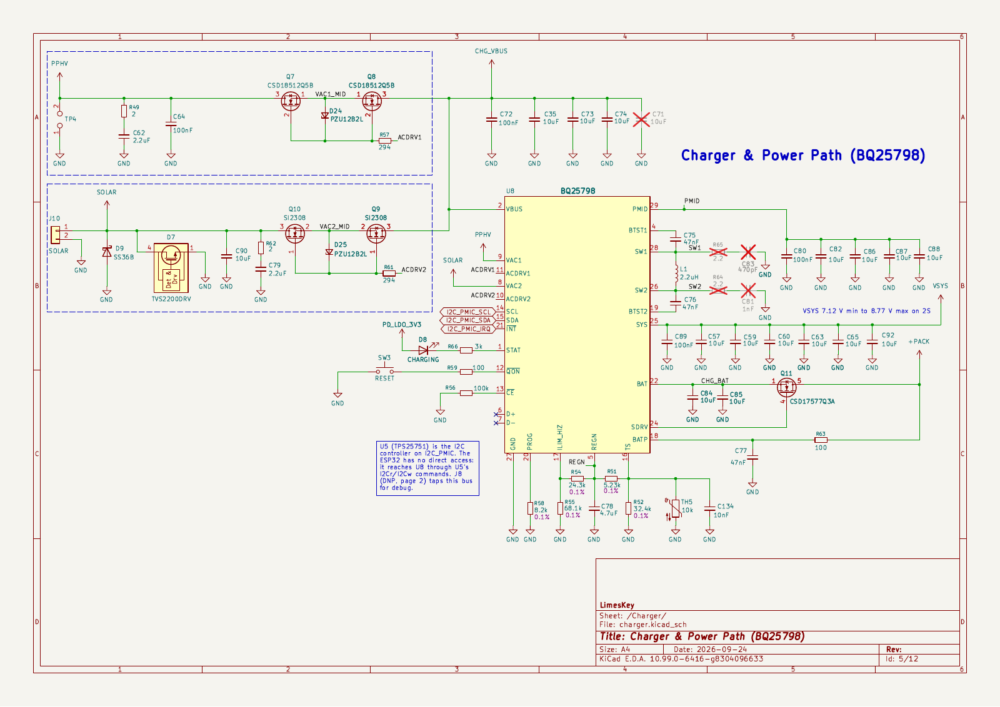</a>
      <br><sub><b>Charger / power path</b></sub>
    </td>
    <td align="center" width="33%">
      <a href="lib/img/schematic-bms.png">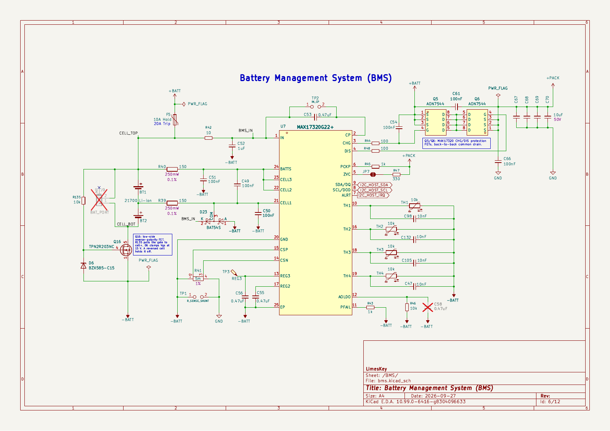</a>
      <br><sub><b>BMS (MAX17320)</b></sub>
    </td>
  </tr>
  <tr>
    <td align="center" width="33%">
      <a href="lib/img/schematic-usb.png">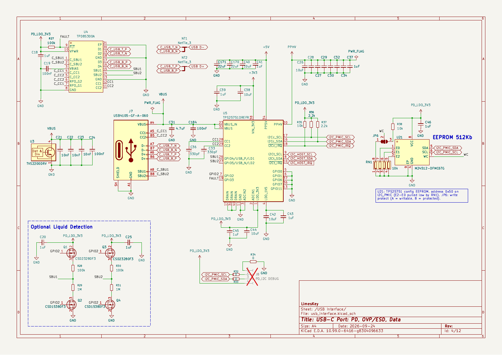</a>
      <br><sub><b>USB-C / PD</b></sub>
    </td>
    <td align="center" width="33%">
      <a href="lib/img/schematic-peripherals.png">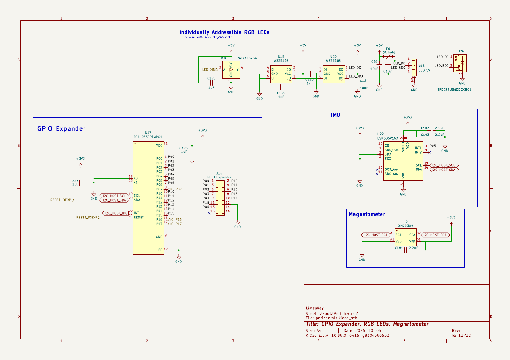</a>
      <br><sub><b>Peripherals</b></sub>
    </td>
    <td align="center" width="33%">
      <a href="lib/img/schematic-connectors.png">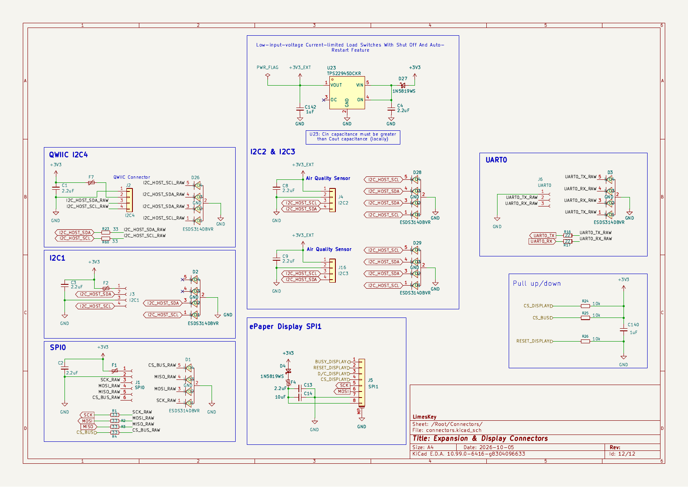</a>
      <br><sub><b>Connectors</b></sub>
    </td>
  </tr>
</table>

## PCB

<table>
  <tr>
    <td align="center" width="50%">
      <a href="lib/img/render-iso.png">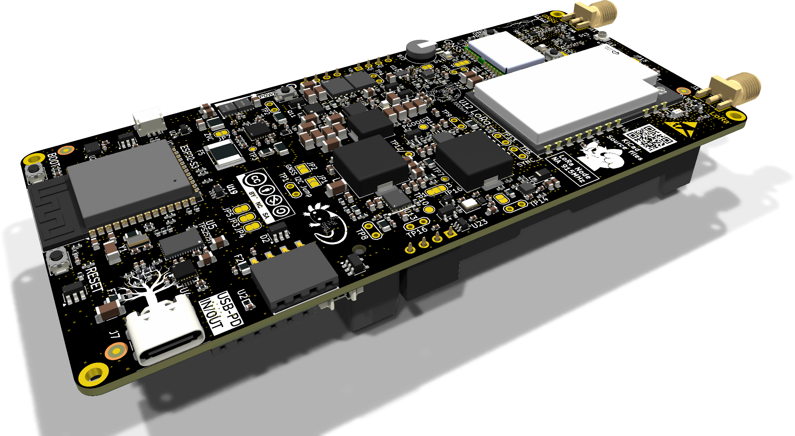</a>
      <br><sub><b>Front</b></sub>
    </td>
    <td align="center" width="50%">
      <a href="lib/img/render-iso-back.png">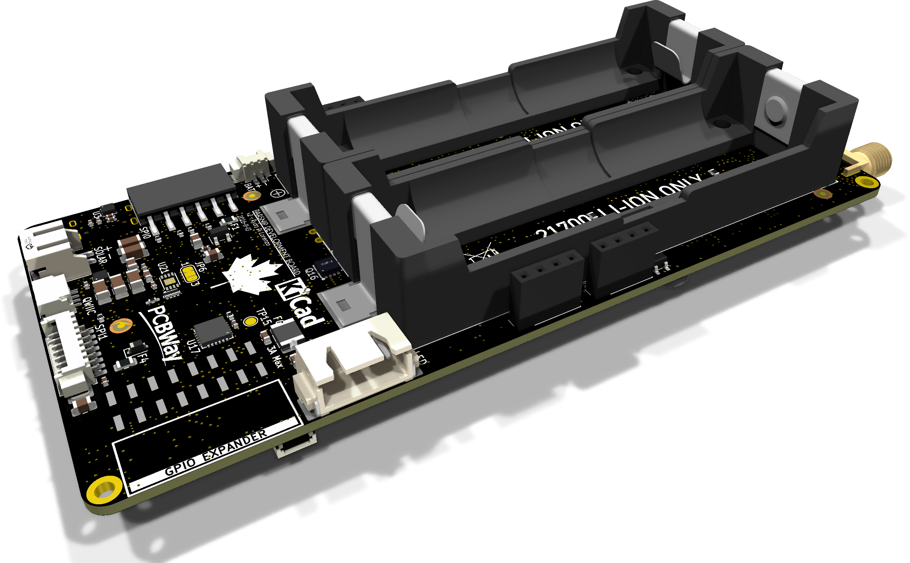</a>
      <br><sub><b>Back</b></sub>
    </td>
  </tr>
  <tr>
    <td align="center" width="50%">
      <a href="lib/img/render-top.png">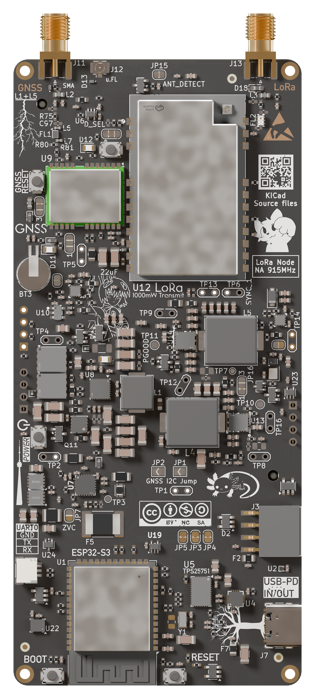</a>
      <br><sub><b>Top</b></sub>
    </td>
    <td align="center" width="50%">
      <a href="lib/img/render-bottom.png">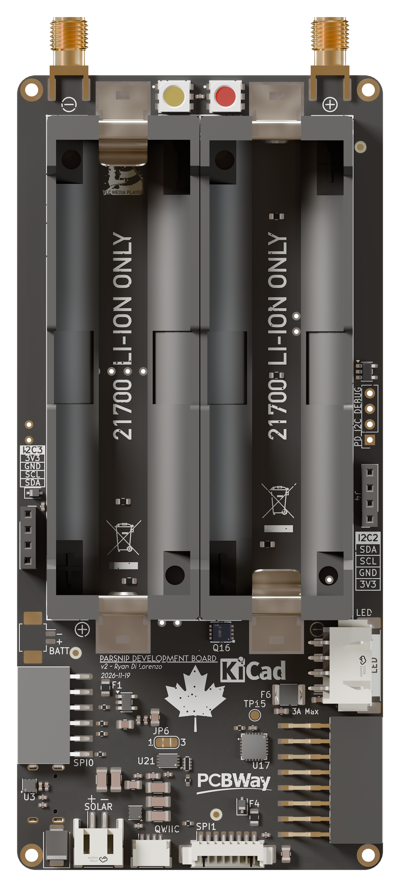</a>
      <br><sub><b>Bottom (21700 holders)</b></sub>
    </td>
  </tr>
</table>

- 60 x 130 mm, 4 layers, 1.6 mm total, 1 oz copper on all layers, ENIG
- Stackup (JLCPCB `JLC041611-7628` equivalent): F.Cu / 0.203 mm prepreg (Er 4.4) / In1 /
  1.03 mm core / In2 / 0.203 mm prepreg / B.Cu
- In1 is a solid GND reference for all RF. RF lines are 0.306 mm on F.Cu, 49-53 ohm
  field-solved with mask, mostly CPWG with GND via fences well under lambda/20
- ~2100 vias (0.3 mm and 0.2 mm drill), most of them GND stitching
- The cell holders take most of the back, so everything above them is single-sided

## Hardware

| Part | Price |
| --- | --- |
| PCB + assembly ([BOM](production/parsnip-bom.csv)) | being quoted |
| 2 x Samsung 58E 21700 cells [18650batterystore.com](https://www.18650batterystore.com/products/samsung-58e-21700-battery) | $40 CAD |
| WeAct 3.7" E-Ink module, 240 x 416, optional [AliExpress](https://www.aliexpress.com/item/1005009712001279.html?mp=1) | $25 CAD |

Production files (gerbers, BOM, pick-and-place) are in [production/](production/).
Datasheets for every IC, module and connector are in
[docs/datasheets/](docs/datasheets/), sources in
[SOURCES.md](docs/datasheets/SOURCES.md).

## ESP32-S3 GPIO map

GPIO numbers are ESP32-S3 GPIO, not module pins. Reference designators can change during
layout; the schematic is authoritative.

#### LoRa: E22P-915M30S

| Signal | GPIO |
| --- | --- |
| NSS | 10 |
| SCK | 12 |
| MOSI | 11 |
| MISO | 13 |
| BUSY | 14 |
| DIO1 | 4 |
| NRST | 40 |
| EN | 41 |

T/R switching comes from the module's DIO2 (`setDio2AsRfSwitch(true)`), not a GPIO.

#### GNSS: NEO-F10N

| Signal | GPIO |
| --- | --- |
| TXD (to host RX, UART1) | 1 |
| RXD (from host TX, UART1) | 2 |
| TIMEPULSE | 3 |
| EXTINT | 48 |

The module's I2C/SPI pins reach the host I2C bus only through solder jumpers, for the
NEO-M9N fallback. The F10N uses UART only.

#### Other

| Function | GPIO |
| --- | --- |
| I2C SDA / SCL (host bus) | 8 / 9 |
| I2C IRQ (PD controller, fuel gauge, GPIO expander) | 7 |
| E-Ink header: BUSY / RESET / D/C / CS | 5 / 6 / 18 / 17 |
| SPI expansion header CS | 38 |
| USB D- / D+ | 19 / 20 |
| UART0 TX / RX (debug header) | 43 / 44 |
| 32.768 kHz RTC crystal | 15 / 16 |
| BOOT | 0 |
| eFuse power-good: 5 V / GNSS 3.3 V | 39 / 42 |
| EMI sync clock gate | 47 |
| RGB LED data (via 5 V level shifter) | 46 |
| 5 V buck disable (high = off) | 21 |
| Octal PSRAM (reserved) | 35 / 36 / 37 |
| VDD_SPI strap (not connected) | 45 |

#### I2C addresses

| Bus | Device | Address |
| --- | --- | --- |
| Host (GPIO 8/9) | TPS25751 USB-PD controller | 0x20 |
| Host | MAX17320 fuel gauge | 0x36, 0x0B |
| Host | LSM6DSV16X IMU | 0x6A |
| Host | TCAL9539 GPIO expander | 0x74 |
| Host | QMC6309 magnetometer | 0x7C |
| PMIC (owned by the TPS25751) | BQ25798 charger | 0x6B |
| PMIC | M24512 EEPROM (PD config) | 0x50 |

## Firmware

Firmware is a Meshtastic fork, tracked as the `firmware` submodule
([LimesKey/firmware](https://github.com/LimesKey/firmware)). A device variant declares
the pin map above and the PA control lines so TX keys up. The GNSS is on UART1, which
stock Meshtastic supports.

```bash
git clone --recurse-submodules https://github.com/LimesKey/parsnip-node.git
```

## Repository layout

| Path | Contents |
| --- | --- |
| `parsnip.kicad_pro` | KiCad project (KiCad 10.99 nightly format; stable 10.0 cannot open it) |
| `*.kicad_sch` | Schematic sheets: seven top-level sheets plus five sub-sheets under the MCU page |
| `parsnip.kicad_pcb` | Board |
| `lib/` | Project symbols, footprints and 3D models |
| `production/` | Gerbers, BOM, pick-and-place |
| `docs/` | Datasheets and photos |
| `JOURNAL.md` | Design log |
| `v1/` | The previous single-cell board |

## v1 in the field

<table>
  <tr>
    <td align="center" width="33%">
      
      <br><sub><b>Assembled board</b></sub>
    </td>
    <td align="center" width="33%">
      
      <br><sub><b>Outdoor testing</b></sub>
    </td>
    <td align="center" width="33%">
      
      <br><sub><b>Outdoor testing, back</b></sub>
    </td>
  </tr>
</table>

## License

[CC BY-NC-SA 4.0](LICENSE)
